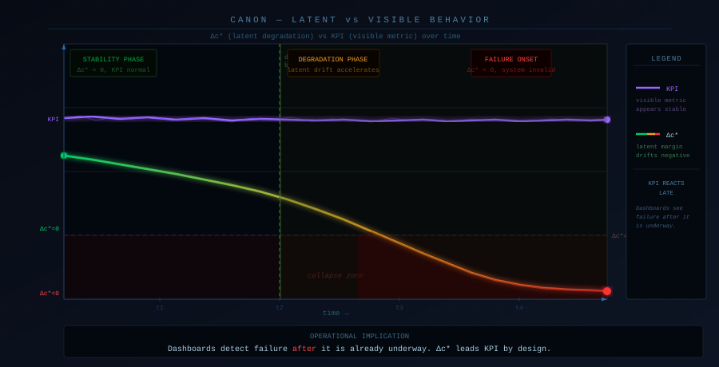
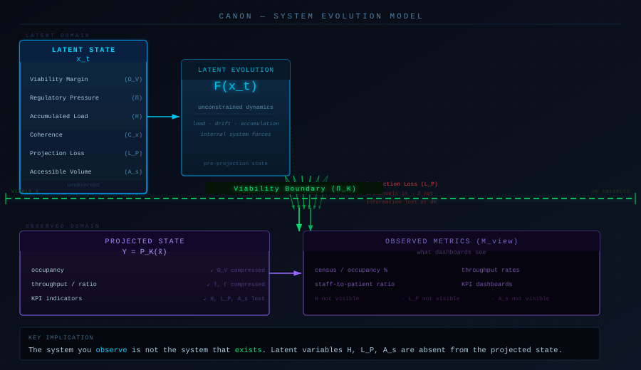
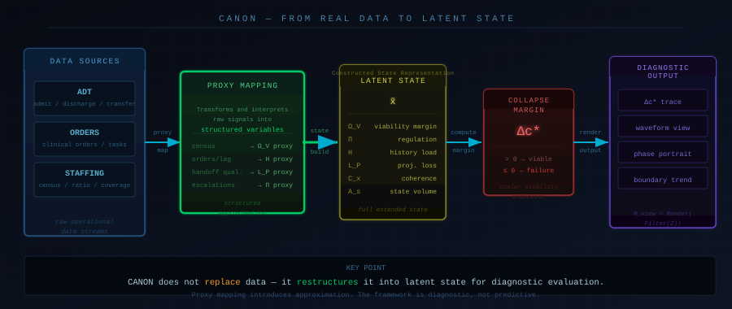

# CANON — Constraint-First Modeling for Systems Under Load


**Research prototype — not empirically validated.** CANON is a proposed modeling
framework with constructed examples and a non-calibrated reference interpreter.
Its state variables are proxy-based approximations. The repository does not
establish earlier detection of real operational failure and is not a clinical
decision-support or production system. The [retrospective evaluation plan](domain/retrospective_evaluation.md)
describes how the hospital-operations hypothesis could be tested.

---

## 🔹 What this is (in 30 seconds)

The framework investigates a familiar operational pattern:

Metrics are stable. Nothing appears broken. Then the system collapses.

Observed metrics can omit information about a system's underlying state. CANON
explores whether explicitly modeling constraints and accumulated load can make
such differences inspectable.

**CANON models the underlying state.**

If you've seen "everything was fine until it wasn't," this framework offers a
way to formulate and investigate that problem.

---

## 🔹 The core insight

Two systems can show identical metrics and be in completely different states.

In the constructed example below, one is stable and one is failing under the
chosen model. The selected KPI is identical, so that KPI alone cannot distinguish
the two modeled states.



**How to read this:**
- The flat line is the selected illustrative KPI.
- The descending line is the constructed Δc\* trajectory.
- The shaded region represents a modeled state difference omitted by that KPI.
- Δc\* crosses zero before the example's failure point by construction.

The mathematical point is that a many-to-one observation can map different
states to the same output. This chart illustrates that possibility; it does not
show empirical detection lead time or prove that CANON reconstructs real latent
state. Whether its proposed proxies add useful information beyond existing
operational metrics remains a testable hypothesis.

---

## 🔹 What that looks like in numbers

Two constructed shift scenarios. Same selected census and staffing metrics.
The values below are illustrative model inputs and outputs, not observations
from patient records or measured hospital shifts.

| Setup   | ΩV   | H    | L_P  | Δc\*   |
|---------|------|------|------|--------|
| Stable  | 0.52 | 0.12 | 0.10 | +0.06  |
| Failing | 0.42 | 0.45 | 0.35 | −0.11  |

Both look equivalent at the selected KPI layer. Their assigned model states
differ: one is within the chosen viable region and one has left it.

This makes the proposed distinction computable within the example, without
establishing that the proxy mapping is valid in practice.

---

## 🔹 What CANON actually is

CANON (Constrained Autonomous Node-state Operational Network) is:

- a **state model** — not a metric
- a **constraint system** — not a predictor
- a **diagnostic lens** — not a dashboard
- a **structure-mapping framework** — not domain-specific

It answers:

> **"Is the system still viable?"**

Not:

> "What are the numbers?"

---

## 🔹 The governing principle

```
x_{t+1} = Π_K(F(x_t))
```

The system evolves through its internal dynamics (`F`), then is projected back into what it can actually sustain (`Π_K`). The gap between those two — between what the system *tries* to do and what it is *constrained* to do — is where failure begins.

CANON emphasizes the modeled constraint projection `Π_K` alongside the dynamics
`F`; this is a modeling choice rather than an evaluation of other frameworks.

---

## 🔹 Invariant Governance

Invariant Governance defines how preserved goal-invariants are discovered, contested, revised, and used to hold constraints accountable.

It sits above the CANON operator layer and does not modify the executable core.

CANON answers:

> Is this state admissible under the constraint system?

Invariant Governance answers:

> Admissible relative to what preserved goal?

Start here:

- [`theory/CANON_INVARIANT_GOVERNANCE.md`](theory/CANON_INVARIANT_GOVERNANCE.md) — theory-layer bridge between preserved goals, invariant sets, K, state evolution, drift, and renewal
- [`spec/INVARIANT_GOVERNANCE_SCHEMA.json`](spec/INVARIANT_GOVERNANCE_SCHEMA.json) — machine-readable invariant record schema
- [`examples/boh_invariant_governance.md`](examples/boh_invariant_governance.md) — first contained worked example using BOH
- [`domain/los_invariant_map.md`](domain/los_invariant_map.md) — downstream healthcare / Line of Service domain bridge

---

## 🔹 Core variables

- **ΩV** — viability margin (remaining operational headroom)
- **Π** — regulatory pressure (effort to stay feasible)
- **H** — accumulated load (path-dependent history, invisible to dashboards)
- **L_P** — projection loss (structural information destroyed by observation)

Failure occurs when the system leaves its viable state space — not when a single metric crosses a threshold.

---

## 🔹 The system flow



**How to read this:**
- Top layer: latent domain — x_t evolves through F(x_t), unobserved
- Π_K: viability boundary — a spatial constraint, not a process step
- Funnel: projection loss — latent channels compress into observable outputs
- Bottom layer: observed domain — what dashboards see (H, L_P absent)

This diagram expresses CANON's proposed separation between a fuller modeled
state and its observable projection. Reconstructing that state from real data
requires proxy assumptions and evaluation.

---

## 🔹 Demonstration domain: hospital operations

CANON is applied to hospital shift operations not because that is the limit of the framework, but because it is where the failure mode is most legible:

- metrics are standardized (census, LOS, throughput)
- failure modes are well-documented
- the gap between observable KPIs and latent system state is large and consequential

Hospital systems are the demonstration domain. Applying the formalism elsewhere
would require domain-specific state definitions, constraints, and validation.

See `examples/shift_failure_case.md` for a constructed walkthrough informed by
hospital-operations literature. Those references motivate the scenario; they do
not constitute empirical validation of CANON or its numerical outputs.

For the full integrated reference view of the hospital domain application:

- [`atlas/canon_los_atlas.html`](atlas/canon_los_atlas.html) — CANON × Hospital Operations integrated reference atlas (v3.9.53): variables, constraints, failure channels, and domain mapping in a single navigable artifact

---

## 🔹 Orthogonal application

CANON operates at the level of:

- constraint
- load accumulation
- state evolution
- viability boundaries

These concepts suggest possible comparisons across domains:

- hospital flow ↔ distributed systems
- biology ↔ organizational design
- coordination patterns ↔ information systems

Structural similarities are a starting point for modeling, not evidence that
one domain's proxy definitions or results transfer unchanged to another.

---

## 🔹 Start here

If you're new, begin with the examples — this takes ~5 minutes and builds full intuition:

1. `examples/shift_failure_case.md` — a shift that collapses despite stable KPIs
2. `examples/shift_contrast_case.md` — same visible setup, different latent state, different outcome
3. `examples/toy_delta_c_comparison.md` — numeric illustration of latent state divergence

Then:

4. `domain/input_mapping.md` — how real-world signals map to CANON variables
5. `domain/retrospective_evaluation.md` — how this can be tested against real data

---

## 🔹 How real data connects to CANON state



**How to read this:**
- Left: raw operational data sources (ADT, Orders, Staffing)
- Proxy Mapping: signals are interpreted into CANON variables — not relabeled, restructured
- Center: constructed latent state x̃, with adjunct variables populated
- Right: Δc\* computed from latent state, rendered as diagnostic output

This is a proposed data-to-state workflow. Its outputs are exploratory model
diagnostics, not validated clinical or operational recommendations.

---

## 🔹 Patterns this framework investigates

Constructed examples explore how selected metrics might omit distinctions such as:

- identical metrics → different outcomes
- stable dashboards → failing systems
- sudden collapse → slow latent degradation
- no individual failure → systemic breakdown

---

## 🔹 Repository structure

```
/theory          — governing equations, operators, observability framework
/spec            — machine-readable execution specification (v3.9.53)
/domain          — input mapping, data schema, retrospective evaluation
/examples        — grounded case studies and numeric comparisons
/atlas           — system diagrams and reference visualizations
/implementation  — prototype interpreter (Python)
```

---

## 🔹 Formal system references

- `theory/CANON_MATH_v1.md`
- `theory/CANON_OPERATORS.md`
- `theory/CANON_OBSERVABILITY.md`
- `theory/CANON_GOVERNING_LAYER.md`
- `theory/CANON_INVARIANT_GOVERNANCE.md`
- `spec/CANON_SYSTEM_v3.9.53.json`
- `spec/INVARIANT_GOVERNANCE_SCHEMA.json`

---

## 🔹 Interactive atlas

Two navigable HTML reference artifacts are included for deeper orientation:

- [`atlas/canon_influence_architecture.html`](atlas/canon_influence_architecture.html) — the full influence architecture of the CANON system: how variables relate, propagate, and interact across the constraint boundary
- [`atlas/canon_los_atlas.html`](atlas/canon_los_atlas.html) — the hospital operations domain instantiation: variables mapped to real operational signals, constraints defined, failure channels identified

These are standalone reference artifacts — no server required, open directly in a browser.

---

## 🔹 Scope

This repository is:

- a system model
- an observability framework
- a diagnostic structure

This repository is not:

- a production system
- a predictive tool
- a clinical deployment

---

## 🔹 Limitations

- not empirically validated against real datasets
- proxy-based variable mapping (approximation, not measurement)
- interpreter is prototype-grade, non-calibrated

Future work:

- real dataset evaluation against shift-level KPI baselines
- calibration of proxy estimation functions
- measurement of detection lead time vs. standard metrics

The domain files support this directly:
- `domain/input_mapping.md`
- `domain/data_schema.md`
- `domain/retrospective_evaluation.md`

---

## 🔹 Summary

Traditional systems ask:

> "What are the numbers?"

CANON asks:

> **"Is the system still viable?"**

The research question is whether useful warning can be established before a
specified KPI baseline changes. That has not yet been demonstrated on real data.

